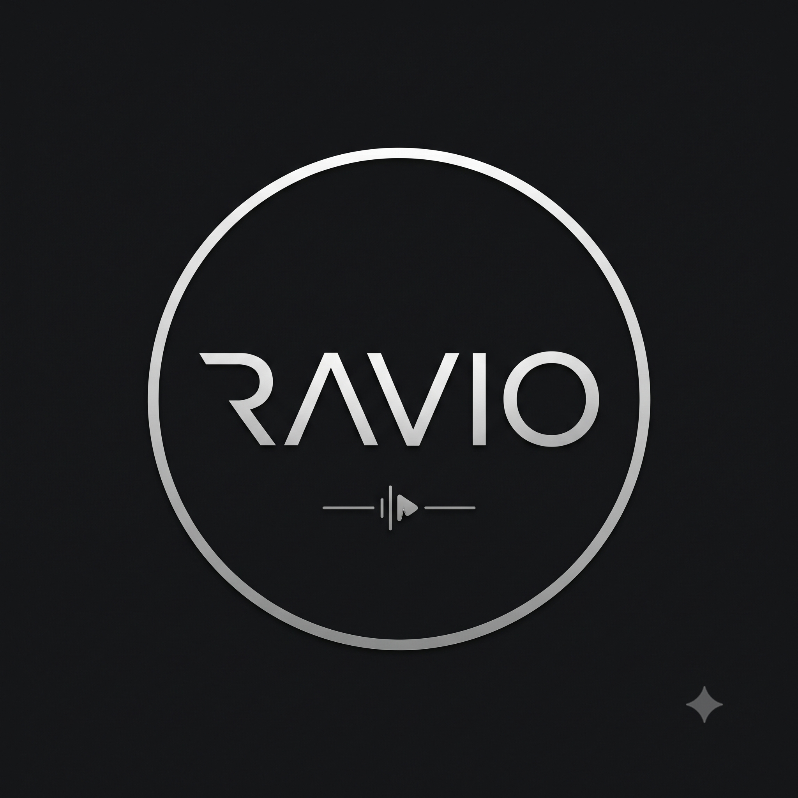

  

  # RAVIO MUSIC
  **Pure Music. Zero Limits.**

  A high-precision, zero-telemetry Android music streaming client equipped with **Ravio Brain AI**, **Dual 10-Band DSP Equalizer**, **Ravio Find**, and **Time-Synced Lyrics**.

  
  
  
  

  [**Download Latest APK**](https://github.com/raviomusic/raviomusic.github.io/releases/latest/download/Ravio.apk) • [**Official Website**](https://raviomusic.github.io) • [**Privacy Policy**](https://raviomusic.github.io/privacy) • [**Terms of Service**](https://raviomusic.github.io/terms)

---

## Overview

**Ravio Music** is a lightweight, modern Material 3 audio player and streaming client for Android designed and maintained by [**Raman Chapagain**](https://ramanchapagain.github.io). Built for audiophiles who value speed, acoustic precision, and complete privacy, Ravio operates on a strict local-first architecture with zero advertisements and zero background tracking.

---

## Core Features

| Feature | Description |
| :--- | :--- |
| **Ravio Brain AI** | Built-in AI music curator that generates custom taste mixes, Vibe Summaries, Song DNA backstories, and instant live lyrics translations. |
| **Dual 10-Band EQ** | Studio-grade multi-band equalizer with DSP bass boost, loudness enhancer, 3D virtualizer, pitch/tempo shift, and silence skipping. |
| **Unlocked Streaming** | 100% free, ad-free background playback with offline song caching and local audio file (`MP3`, `FLAC`, `WAV`) playback. |
| **Time-Synced Lyrics** | Word-by-word and line-synced lyrics, expressive canvas visuals, and one-tap AI language translations. |
| **Ravio Find** | On-demand acoustic audio recognition to identify songs playing around you. |
| **Material You & AMOLED** | Dynamic wallpaper theming, Pure Black AMOLED mode, custom grid layouts, and blurred album art backdrops. |
| **Android Auto & Cast** | Seamless queue management and playback control via Android Auto and external speaker casting. |

---

## Privacy & Zero-Telemetry Architecture

* **No Data Harvesting:** Ravio contains zero analytics SDKs, crash-reporting spyware, or behavioral trackers.
* **100% Ad-Free:** No banner ads, audio interruptions, or advertising IDs.
* **On-Device Storage:** All playlists, listening stats, DSP equalizer curves, and offline caches remain inside your phone's local storage with full local backup and restore support.

Read the full [**Privacy Policy**](https://raviomusic.github.io/privacy).

---

## Installation

1. Download the latest `Ravio.apk` from [**GitHub Releases**](https://github.com/raviomusic/raviomusic.github.io/releases/latest/download/Ravio.apk) or the [**Official Website**](https://raviomusic.github.io).
2. Open the downloaded APK file on your Android device.
3. Grant permission to install from your browser/file manager if prompted.

---

## Support the Project

Ravio Music is 100% free and ad-free. If you enjoy using Ravio, you can support ongoing development:

* **eSewa:** `9846620752`
* **Litecoin (LTC):** `ltc1quwyt9xhc262szelwt44mdkwdcjzawqusrjp4vd`
* **Developer Portal:** [ramanchapagain.github.io](https://ramanchapagain.github.io)

---

## Disclaimer & License

* **Third-Party Client Disclaimer:** Ravio Music is a third-party streaming client and does not host, store, or distribute any copyrighted audio content on its own servers.
* **Copyright & License:** © Raman Chapagain. All rights reserved. Ravio Music is provided as freeware for personal, non-commercial use. Unauthorized decompilation, modification, rebranding, or redistribution of modified APK builds is strictly prohibited. See the [**Terms of Service**](https://raviomusic.github.io/terms) for full details.
